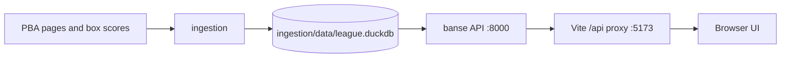

# Adbansed Stats

Basketball statistics for Philippine leagues. The current dataset is the PBA
50th Season Governors' Cup. The project is split into four directories under
`repos/`:

| Directory | Role |
| --- | --- |
| [`ingestion`](repos/ingestion/README.md) | Python retrieval, cleaning, identity matching, and storage. It writes the DuckDB database. |
| [`banse`](repos/banse/README.md) | Read only FastAPI service. It queries the DuckDB database and returns tournament, team, player, game, and box score data. |
| [`ui`](repos/ui/README.md) | TypeScript and Vite website. It requests data from Banse and renders the home, statistics, player, team, and game pages. |
| `datasource/pba` | Standalone PBA box score export/debug script. It uses the ingestion parser but is not needed to run the API or website. |



Ingestion runs when you want to add or update data. Banse only reads the database;
the UI never opens DuckDB directly. During local development, Vite forwards browser
requests for `/api` to Banse at `http://127.0.0.1:8000`. Banse currently serves
DuckDB, although ingestion can also write SQLite. The data directory is local and
ignored by Git, so a fresh clone needs an ingestion run or a copy of the database.
The optional [private ingestion API](repos/ingestion/README.md#private-ingestion-api)
can start those CLI operations on loopback; it is not part of the public UI path.

## Run locally with Make

From the project root, you need `make`, `npm`, and Python 3.10 or newer. The
Makefile defaults to `python3.14`; check that it is available with
`python3.14 --version`. If you use another supported interpreter, pass it to
setup, for example `make setup PYTHON=python3.12`.

The API also needs the populated DuckDB file at
`repos/ingestion/data/league.duckdb`. The `data` directory is ignored by Git,
so a fresh clone needs a copy of the existing database or an
[ingestion run](repos/ingestion/README.md) first. `make setup` installs code
dependencies; it does not create or populate the database.

1. Install the API and UI dependencies once:

   ```sh
   make setup
   ```

2. Start Banse and Vite together:

   ```sh
   make dev
   ```

3. Open the UI at <http://127.0.0.1:5173>. Check the API at
   <http://127.0.0.1:8000/api/tournaments>; its interactive docs are at
   <http://127.0.0.1:8000/docs>.

Press **Ctrl-C** in the `make dev` terminal to stop both services. For later
sessions, run only `make dev`. If either service exits, the launcher stops the
other one too.

`make setup` creates Banse's virtual environment and installs the UI's
project-local Node 22 dependency. The launcher uses that Node binary even if
the system's `node --version` reports 16.16.0. If an existing Banse virtual
environment was created with Python 3.9, recreate it with a supported Python
version before running `make setup` again, for example:

```sh
python3.14 -m venv --clear repos/banse/.venv
make setup
```

Docker is not needed for local development here: the running pieces are one
FastAPI process, one Vite process, and a local DuckDB file. The launcher handles
their startup and shutdown without containers. Docker could be useful later for
deployment or a shared environment across machines, but would add image builds
and database volume configuration to this setup.

For a production VM, follow the [deployment runbook](docs/DEPLOYMENT.md). It
covers HTTPS, service management, DuckDB updates, scheduled retrieval, backups,
and recovery. The [future proxy plan](docs/PROXY_PLAN.md) describes when and how
to introduce `repos/proxy` if the API later needs a separate application gateway.
The [automated ingestion plan](docs/AUTOMATED_INGESTION_PLAN.md) covers a staged
path from scheduled retrieval to guarded, repeatable imports.

## Update the data

The detailed PBA retrieval and import steps are in the
[`ingestion` guide](repos/ingestion/README.md). The current UI and API display
only games that have been imported into `league.duckdb`. To see newly completed
games, run ingestion again against that database, then reload the UI. If DuckDB
reports a file lock, stop Banse during the import and restart it afterward.
